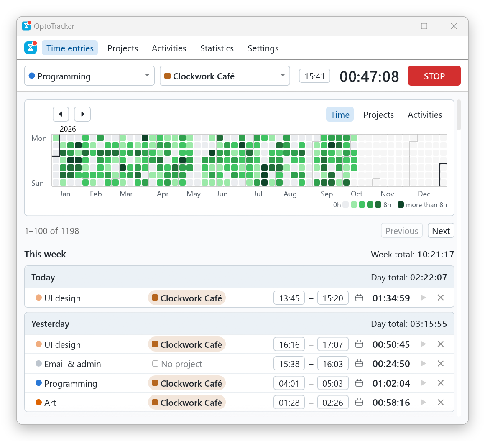
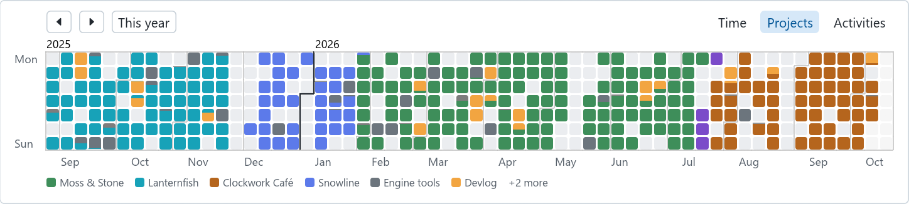
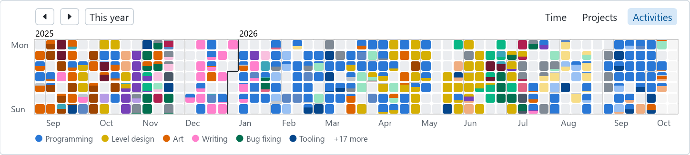
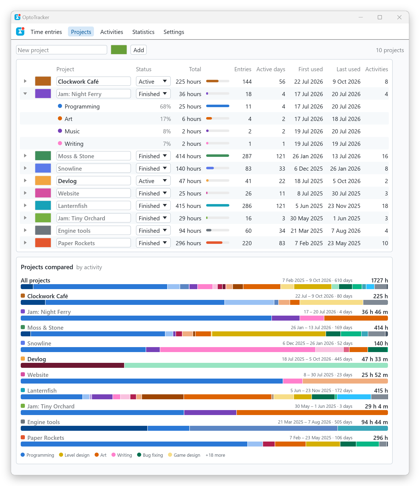
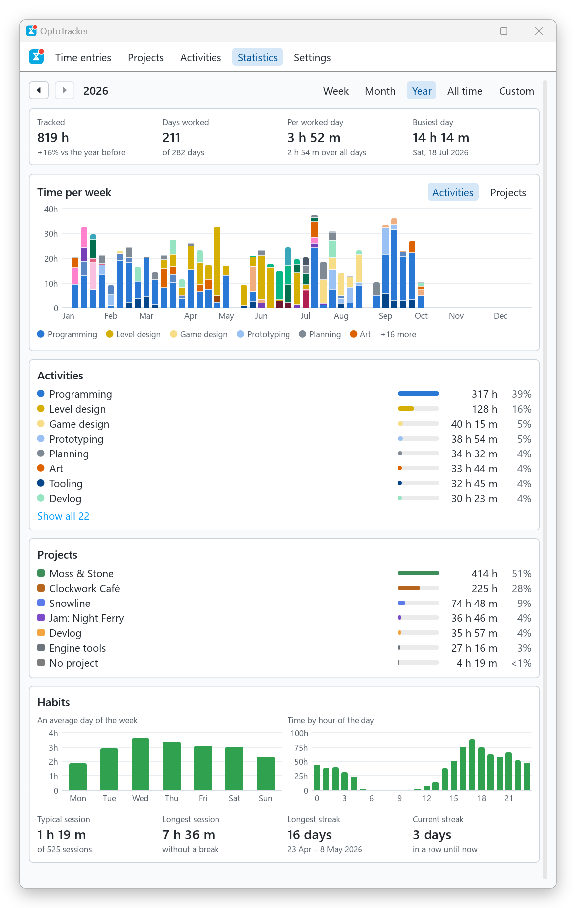
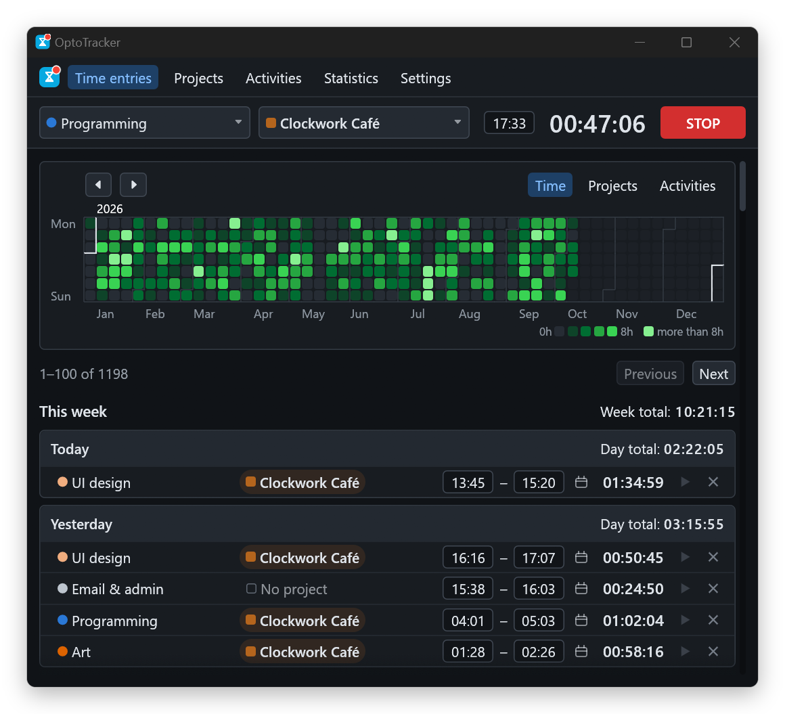

# OptoTracker

A small time tracker for one person. It runs on your own computer, needs no
account and no server, and keeps everything in a single JSON file that you own.

<p align="center">
  
</p>

OptoTracker is inspired by [Clockify](https://clockify.me): start a timer, say
what you are working on, and later see where the time went. It keeps that core
and leaves out everything a team needs.

- **One file that you own.** All of your tracked time is in `data.json`, a
  readable file on your disk. This is the
  [file over app](https://stephango.com/file-over-app) philosophy known from
  Obsidian: applications come and go, and the file should outlast them. You can
  read it, back it up, put it under version control or analyze it with a short
  script, with or without OptoTracker.
- **Local, for one user.** There are no users, workspaces or permissions, and
  the application never connects to the network.
- **Simple.** The whole model is projects, activities and time entries. There
  is one timer, and every change is saved the moment you make it.

The screenshots show generated demo data.

## Features

### Timer and entries

- Pick an activity and, if you want, a project, and press **START**. One timer
  runs at a time.
- Started the timer late? Type the real start time into the field next to the
  clock. The timer keeps running.
- Finished entries are grouped by day and week, with totals. The start time,
  stop time, date, activity and project of an entry are all edited in place.
- ▶ starts a new timer with the activity and project of an old entry.
- A forgotten timer stops by itself after 24 hours, which is also the longest
  an entry can be.

### Calendar

The calendar shows the year the way GitHub shows contributions. It can color
the days by tracked time, as in the picture above, or by project or activity,
where each day is divided in proportion to the time spent on it. Hover over a
day to see its numbers, click it to jump to its entries, and drag or page the
calendar back through earlier years.

By project:



By activity:



### Projects and activities

An activity is the kind of work, such as programming or writing. A project is
what the work is for. Activities are shared between projects, so you can ask
both what a project consisted of and where all the writing went.

Each tab lists the total time, the number of entries, the active days and the
first and last use. A project row expands into its activities, and an activity
row into its projects. Below the table, every project is drawn as a bar divided
by activity. A finished project keeps its history and moves below the active
ones in the project selector.

<p align="center">
  
</p>

### Statistics

For a week, a month, a year, all time or any range of days, the Statistics tab
shows the total and how it compares with the period before, the time per day,
week or month divided by activity or project, and your habits: the average
weekday, the hours of the day you work at, the typical session and your streaks.

<p align="center">
  
</p>

### Light and dark

OptoTracker follows the app mode of Windows, light or dark. To keep one theme
whatever Windows is set to, choose it in Settings.

<p align="center">
  
</p>

### Windows integration

- Closing or minimizing the window sends OptoTracker to the tray. This can be
  turned off in Settings.
- The window, taskbar and tray icons show whether a timer is running.
- It can start when you sign in, minimized to the tray.
- Only one copy runs at a time.

## Your data

Everything you track is in `%APPDATA%\OptoTracker\data.json`:

```json
{
  "format_version": 2,
  "projects": [
    {
      "name": "Clockwork Café",
      "color": { "red": 181, "green": 101, "blue": 29 },
      "status": "Active"
    }
  ],
  "activities": [
    { "name": "UI design", "color": { "red": 240, "green": 173, "blue": 127 } },
    { "name": "Programming", "color": { "red": 42, "green": 120, "blue": 214 } }
  ],
  "time_entries": [
    {
      "id": 1,
      "activity": 0,
      "project": 0,
      "time": { "started_at": 1791542700, "stopped_at": 1791548400 }
    }
  ],
  "active_entry": { "activity": 1, "project": 0, "started_at": 1791549660 }
}
```

- `activity` and `project` are positions in the two lists, and `project` may be
  `null`. For that reason projects and activities are never deleted or
  reordered; a project that is over is marked `Finished` instead.
- Times are Unix seconds in UTC. They are shown in the local time of the
  computer, and an entry that crosses midnight counts towards both days.
- `active_entry` is the running timer, or `null` when nothing is running.

OptoTracker is careful with this file:

- Every change is checked and written immediately, and the file is replaced in
  one step, so a crash cannot leave half of it behind.
- Once a week the file is copied to `backups\data-2026-W41.json` (the year and
  week number) next to it before it is changed.
- If the file cannot be read or is not valid, OptoTracker reports the problem
  and exits. It never starts empty over existing data.

To keep the file somewhere else, pass its path:

```powershell
OptoTracker.exe D:\Documents\time.json
```

The file is used where it is and nothing is copied. OptoTracker expects to be
the only program that changes the file while it is running.

The only other file is `temp.ron` in `%APPDATA%\OptoTracker`, which remembers
the window size, your settings and your last selections. It can be deleted at
any time.

## Installing

OptoTracker runs on Windows. Download `OptoTracker.exe` from the
[latest release](../../releases/latest) and run it; it is a single file that
needs nothing else. Windows may warn about it the first time, because the file
is not code-signed.

To keep it, open **Settings** and press **Install OptoTracker here**. This
copies the executable to `%APPDATA%\OptoTracker\OptoTracker.exe`, next to the
data. The same tab creates a desktop shortcut and turns on starting with
Windows.

To build it yourself you need Rust 1.95 or newer:

```powershell
cargo run --release
```

[ARCHITECTURE.md](ARCHITECTURE.md) describes the modules, the rules for the
data and what a Linux version would need.

## What it leaves out

There are no teams, clients, billing, tags or estimates, no sync, and no mobile
or web version. There is no import or export either: the data file is the
export. Linux and macOS are not supported yet.

## License

Licensed under either of

- Apache License, Version 2.0 ([LICENSE-APACHE](LICENSE-APACHE) or
  <http://www.apache.org/licenses/LICENSE-2.0>)
- MIT license ([LICENSE-MIT](LICENSE-MIT) or
  <http://opensource.org/licenses/MIT>)

at your option.

Unless you explicitly state otherwise, any contribution intentionally submitted
for inclusion in the work by you, as defined in the Apache-2.0 license, shall be
dual licensed as above, without any additional terms or conditions.
